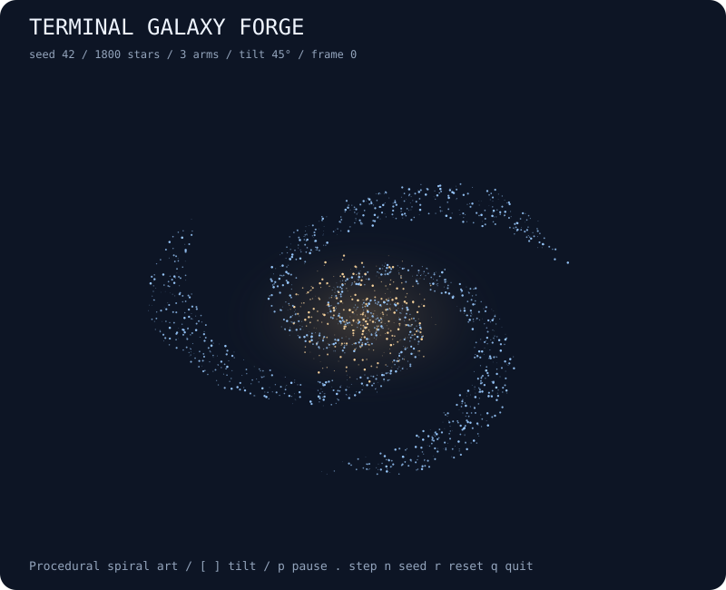

# terminal-galaxy-forge

Seeded spiral galaxies with differential rotation and an adjustable viewing angle.



## Run

```bash
npx --yes github:b69ca/terminal-galaxy-forge
```

Node.js 20 or newer. Zero runtime dependencies. Everything runs locally.

## Play

| Key | Action |
| --- | --- |
| `p` / Space | Pause or resume automatic updates |
| `.` | Pause and advance one step |
| `n` | Start the next seed |
| `r` | Reset the current seed |
| `+` / `-` | Faster or slower display |
| `q` / Ctrl-C | Quit and restore the terminal |

`--stars N` selects 100–5000 stars (default 1800), `--arms N` selects 1–6 spiral arms (default 3), and `--tilt N` selects an integer from 0 to 80 degrees (default 45). `[` / `]` adjust tilt in five-degree increments. Reset and next seed restore the startup viewing angle.

A live session uses an alternate screen and restores the cursor and input mode on exit. `--no-color` and `NO_COLOR=1` disable ANSI colors. Dimensions fit the terminal at startup; very small terminals may clip the minimum grid. Pass explicit dimensions to reproduce a snapshot across terminals.

## Export

```bash
npx --yes github:b69ca/terminal-galaxy-forge --seed 42 --steps 0 --svg preview.svg
npx --yes github:b69ca/terminal-galaxy-forge --seed 42 --steps 0 --json
npx --yes github:b69ca/terminal-galaxy-forge --frames 100
```

Common flags: `--seed N` (0–4294967295), `--width N` (20–120), `--height N` (10–60), `--steps N` (0–10000), `--frames N` (0–100000), `--json`, `--svg FILE`, `--no-color`, and `--help`.

Live mode starts at step zero. Exports and piped output default to 0 steps; `--steps` overrides that. JSON and SVG can be combined; neither accepts `--frames`. Piped output shows at most one plain frame with no ANSI escapes. Live frames show the starting state first and advance between frames; paused frames still count toward a finite frame limit. Exit codes: 0 success, 2 argument or file error.

## How it works

A seeded PRNG samples a logarithmic spiral disk and a small central bulge. Disk stars start near one of 1–6 arms; bulge stars have random phases and smaller radii. Each star retains its radius and rotates at an angular speed proportional to (radius + 0.4)^−0.8, so inner stars move faster and arms wind over time. The viewing tilt projects the disk and its small vertical thickness into two dimensions. Terminal brightness represents projected star density; SVG colors distinguish disk and bulge stars. This is kinematic procedural art, not an N-body simulation: there are no mutual gravitational forces, collisions, or persistent density-wave arms. JSON reports configuration and aggregate geometry rather than every star.

## Library

Install with `npm install github:b69ca/terminal-galaxy-forge`, then:

```js
import { createWorld, step, analyze, renderSVG } from 'terminal-galaxy-forge';
const world = createWorld({ seed: 42, width: 80, height: 36 });
step(world, 40); // Mutates and returns the world.
console.log(analyze(world));
const svg = renderSVG(world);
```

Renderers and `step` accept states created by `createWorld`. Do not change dimensions or replace internal arrays. The library also exports `project(world, particle)`; `world.tilt` may be changed within 0–80 degrees between steps.

## Development

```bash
npm ci
npm run check
```

Tests check determinism, incremental updates, model invariants, validation, rendering, CLI errors, and file exports. CI runs Node.js 20, 22, and 24.

## License

MIT
